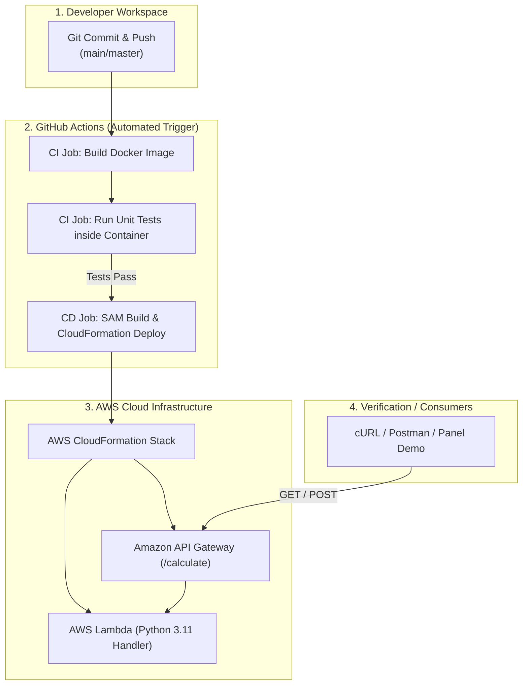

# Python 3.x Calculator CI/CD & AWS Deployment Runbook

> **Target Audience:** DevOps & CI/CD Learning Panel / Student Practice Assignment  
> **Repository Scope:** Minimal, direct, zero-clutter implementation of an end-to-end CI/CD delivery pipeline for a Python 3.x Calculator application.

---

## 1. System Architecture Diagram

### Pipeline Flow


### ASCII Architecture Overview
```text
 +---------------------+           +-----------------------------------------------+
 |  Developer Commit   | --------> |  GitHub Actions Workflow (push trigger)       |
 |  (calculator.py)    |           |                                               |
 +---------------------+           |  [CI Job]                                     |
                                   |   1. Checkout repository                      |
                                   |   2. docker build -t calculator-app .         |
                                   |   3. docker run --rm calculator-app           |
                                   |      (executes unittest suite inside container)|
                                   |                                               |
                                   |  [CD Job] (runs on CI pass)                   |
                                   |   1. Set up AWS SAM CLI                       |
                                   |   2. Configure AWS credentials via Secrets    |
                                   |   3. sam build & sam deploy to CloudFormation |
                                   +-----------------------+-----------------------+
                                                           |
                                                           v
                                         +-----------------------------------+
                                         |      AWS Cloud Infrastructure     |
                                         |  +-----------------------------+  |
                                         |  | Amazon API Gateway (/Prod)  |  |
                                         |  +--------------+--------------+  |
                                         |                 |                 |
                                         |                 v                 |
                                         |  +-----------------------------+  |
                                         |  | AWS Lambda (Python 3.11)    |  |
                                         |  +-----------------------------+  |
                                         +-----------------------------------+
```

---

## 2. Project File Structure

Direct and minimal with zero unnecessary folders:
```text
.
├── .github/
│   └── workflows/
│       └── ci-cd.yml         # Automated GitHub Actions workflow (CI test in Docker -> CD deploy to AWS)
├── .gitignore                # Python and AWS-SAM build cache exclusions
├── Dockerfile                # Container definition executing unit tests
├── calculator.py             # Core Python 3.x calculator (add, subtract, multiply on positive ints)
├── lambda_function.py        # AWS Lambda handler wrapping the calculator logic
├── template.yaml             # AWS CloudFormation / SAM Infrastructure as Code template
├── test_calculator.py        # Unit test suite covering operations and Lambda handler
└── README.md                 # Architecture documentation, Runbook, and Live Demo script
```

---

## 3. Component Details

### A. Python 3 Calculator (`calculator.py`)
Implements positive integer arithmetic operations (`> 0`):
- `add(a, b)`: Returns $a + b$
- `subtract(a, b)`: Returns $a - b$
- `multiply(a, b)`: Returns $a \times b$
- Validates strictly positive integers. Zero, negative numbers, floats, strings, or booleans raise explicit `ValueError` exceptions.

### B. Unit Testing (`test_calculator.py`)
Built with Python's standard `unittest` library (no external dependencies needed):
- Validates mathematical correctness for addition, subtraction, and multiplication.
- Verifies boundary edge cases (zeros and negative integers raise errors).
- Validates type safety (floats, strings, booleans).
- Validates AWS Lambda event parsing and error handling.

### C. Docker Container (`Dockerfile`)
- Base image: `python:3.11-slim`
- Copies source and test code.
- Default command executes verbose unit tests: `python -m unittest test_calculator.py -v`.

### D. AWS CloudFormation / SAM Template (`template.yaml`)
- Declares serverless infrastructure using AWS SAM:
  - `CalculatorFunction`: Lambda function running Python 3.11.
  - API Gateway event bindings:
    - `GET /calculate` (via query parameters: `?op=add&a=10&b=5`)
    - `POST /calculate` (via JSON body: `{"operation": "multiply", "a": 4, "b": 6}`)
  - Outputs: Public API URL and Lambda Function ARN.

### E. GitHub Actions Workflow (`.github/workflows/ci-cd.yml`)
- **Trigger**: Automatic on `push` to `main` or `master` branches (no webhook setup needed).
- **CI Job**: Builds the Docker container and runs unit tests inside that isolated container.
- **CD Job**: On successful test completion, configures AWS credentials, builds the SAM artifact, and deploys the CloudFormation stack (`calculator-app-prod`).

---

## 4. Step-by-Step Runbook

### Step 1: Local Verification
Run the unit tests locally using Python:
```bash
python -m unittest test_calculator.py -v
```
*Expected Output:*
```text
test_add_success (test_calculator.TestCalculator.test_add_success) ... ok
test_invalid_types_raise_error (test_calculator.TestCalculator.test_invalid_types_raise_error) ... ok
test_multiply_success (test_calculator.TestCalculator.test_multiply_success) ... ok
test_negative_input_raises_error (test_calculator.TestCalculator.test_negative_input_raises_error) ... ok
test_subtract_success (test_calculator.TestCalculator.test_subtract_success) ... ok
test_zero_input_raises_error (test_calculator.TestCalculator.test_zero_input_raises_error) ... ok
test_lambda_invalid_operation (test_calculator.TestLambdaHandler.test_lambda_invalid_operation) ... ok
test_lambda_json_body_success (test_calculator.TestLambdaHandler.test_lambda_json_body_success) ... ok
test_lambda_negative_number_validation (test_calculator.TestLambdaHandler.test_lambda_negative_number_validation) ... ok
test_lambda_query_params_success (test_calculator.TestLambdaHandler.test_lambda_query_params_success) ... ok

Ran 10 tests in 0.001s
OK
```

CLI test:
```bash
python calculator.py add 15 25
# Output: Result: 40
```

### Step 2: Containerized Execution
Build and run the container locally:
```bash
# 1. Build the Docker image
docker build -t calculator-app .

# 2. Run unit tests inside the container
docker run --rm calculator-app
```

### Step 3: Setting Up GitHub Repository Secrets
To allow the CD job to deploy to AWS, configure the following secrets in GitHub (**Repository Settings -> Secrets and variables -> Actions**):
- `AWS_ACCESS_KEY_ID`: IAM user access key with CloudFormation, Lambda, IAM, and API Gateway permissions.
- `AWS_SECRET_ACCESS_KEY`: IAM user secret access key.
- `AWS_REGION`: AWS region (e.g., `us-east-1`).

### Step 4: Triggering the Pipeline
Commit and push changes to GitHub:
```bash
git add .
git commit -m "feat: complete calculator app with Docker CI and AWS SAM CD"
git remote add origin https://github.com/<your-username>/<your-repo>.git
git push -u origin main
```
- The push triggers `.github/workflows/ci-cd.yml` automatically.
- GitHub Actions spins up an Ubuntu runner, builds the Docker image, and executes tests in the CI stage.
- Once tests pass, the CD stage executes `sam deploy` to provision or update the CloudFormation stack in AWS.

---

## 5. Live Demo Script for the DevOps/CI-CD Learning Panel

When presenting to the learning panel, follow this concise 5-minute walkthrough:

### Part 1: Code & Unit Tests (1 minute)
1. **Show `calculator.py`**: Explain the positive integer constraint and math functions (`add`, `subtract`, `multiply`).
2. **Execute tests**:
   ```bash
   python -m unittest test_calculator.py -v
   ```
   Highlight that edge cases (zero, negative numbers, non-integers) are tested and verified.

### Part 2: Containerization (1 minute)
1. **Show `Dockerfile`**: Point out how standard base images keep it lightweight and reproducible across developer machines and CI servers.
2. **Show container run**:
   Explain how the CI job runs `docker run --rm calculator-app:latest python -m unittest test_calculator.py -v` ensuring environment parity.

### Part 3: GitHub Actions CI/CD Pipeline (1.5 minutes)
1. **Show `.github/workflows/ci-cd.yml`**:
   - Point out `on: push` (no manual webhooks or external triggers needed).
   - Show Job 1 (`ci`): Docker build and test runner.
   - Show Job 2 (`cd`): Dependency on `ci` (`needs: ci`), AWS credential configuration, and automated SAM deployment.

### Part 4: AWS Infrastructure as Code (SAM/CloudFormation) (1 minute)
1. **Show `template.yaml`**: Explain Serverless transform, Lambda configuration, and HTTP API endpoints (`/calculate`).
2. **Verify Deployed Endpoint**:
   ```bash
   # Test Addition
   curl "https://<api-id>.execute-api.<region>.amazonaws.com/Prod/calculate?op=add&a=12&b=8"
   # Expected response: {"operation": "add", "a": 12, "b": 8, "result": 20}

   # Test Negative Validation via API
   curl "https://<api-id>.execute-api.<region>.amazonaws.com/Prod/calculate?op=multiply&a=-5&b=2"
   # Expected response (400 Bad Request): {"error": "Argument 'a' must be a positive integer (> 0), got -5."}
   ```

### Part 5: Q&A / Teardown
If asked how infrastructure is deleted after the assignment:
```bash
sam delete --stack-name calculator-app-prod --no-prompts
```

